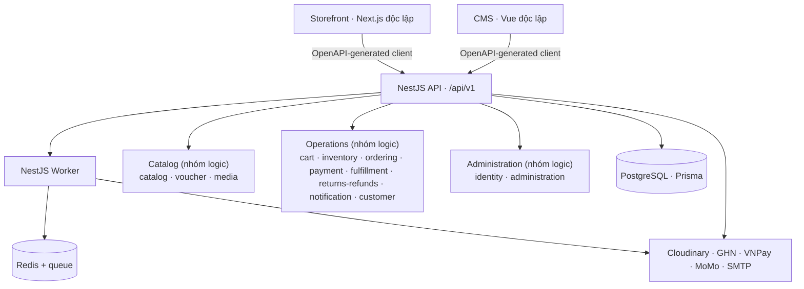

# Tái cấu trúc API, CMS và Storefront

Tài liệu liên repo, gồm spec 11, kế hoạch triển khai, cây thư mục đích và bản đồ thuật ngữ. Thứ tự API-first theo tier được cập nhật ngày 14/11/2026. Các mục ghi quyết định theo ngày phản ánh lịch sử lập kế hoạch. Dùng OpenAPI đã phát hành để đối chiếu hợp đồng đang triển khai.

- [Glossary map](#glossary-map)
- [Spec 11](#spec-11)
- [Kế hoạch triển khai](#kế-hoạch-triển-khai)
- [Cây thư mục đích](#cây-thư-mục-đích)
- [Đối chiếu BE và CMS](#đối-chiếu-be-và-cms)

## Glossary map

Workspace này gồm ba repo với hai bối cảnh thuật ngữ. Mọi tên module, model, feature, DTO và câu chữ trong tài liệu lấy từ đúng glossary dưới đây.

| Bối cảnh              | Glossary                                              | Phạm vi                                                                                                                                                                             |
| --------------------- | ----------------------------------------------------- | ----------------------------------------------------------------------------------------------------------------------------------------------------------------------------------- |
| Nghiệp vụ (canonical) | [`be-demo/GLOSSARY.md`](../../../be-demo/GLOSSARY.md) | Mọi khái niệm nghiệp vụ: Người mua, Tài khoản nội bộ, Sản phẩm, Biến thể, Voucher, Giỏ hàng, Tồn kho, Đơn hàng, Thanh toán, Đổi trả, Vận đơn, dữ liệu cá nhân. Dùng cho cả ba repo. |
| Kỹ thuật CMS          | [`cms/GLOSSARY.md`](../../../cms/GLOSSARY.md)         | Chỉ thuật ngữ kỹ thuật của app Vue: Session, App runtime, Access token, Refresh cookie, Hết phiên, Mất kết nối, Shared module. Không định nghĩa lại nghĩa nghiệp vụ.                |
| Storefront            | `GLOSSARY.md` khi có                                  | Bổ sung cách diễn đạt và ngữ cảnh hiển thị tại storefront. Thuật ngữ dùng chung theo glossary của API.                                                                              |

Quy tắc:

- Định nghĩa nghiệp vụ dùng chung nằm ở `be-demo/GLOSSARY.md`. Frontend không tạo tên UI riêng cho cùng khái niệm (không `Promotion`/`Coupon` cho Voucher, không `User` cho Tài khoản nội bộ).
- Tên feature CMS/storefront ở dạng số nhiều của tên module API là mapping chủ ý (`customers` → `customer`), không phải thuật ngữ mới.
- Quyết định kiến trúc nằm ở [kế hoạch triển khai](#kế-hoạch-triển-khai), [cây thư mục đích](#cây-thư-mục-đích) và `be-demo/docs/architecture/`. ADR hiện có trong `be-demo/docs/adr/` là hồ sơ đóng băng.

## Spec 11

Spec cha cho ba repo. Các nhánh triển khai theo `<type>/<slice>-<slug>`. Ticket triển khai nằm trong tracker của repo phụ trách.

### Problem Statement

Hệ thống bán thời trang B2C hiện có ba codebase không khớp nhau:

- **API (`be-demo`)** mới có Identity và Catalog. Phân quyền dựa trên vai trò cố định (`ADMIN`/`STAFF`) kiểm bằng tên, nên Admin không cấu hình được quyền cho nhân sự. Chưa có Giỏ hàng server, Tồn kho, Đơn hàng, Thanh toán, Vận đơn, Đổi trả, email hay tuân thủ dữ liệu cá nhân. Layout module còn lẫn kiểu cũ (`controllers/ services/ dto/` lồng trong module).
- **CMS (`cms`)** được dựng trước API: dùng `StoreScope`/`X-Store-Id` cho mô hình nhiều cửa hàng không tồn tại, gọi "Promotion/Coupon" thay vì Voucher, kiểm quyền theo tên vai trò, và có màn hình prototype chạy trên dữ liệu giả. Màn hình đơn hàng cho chọn trạng thái tuỳ ý thay vì chỉ các hành động API cho phép.
- **Storefront (`fe-ecommerce-nike-style`)** là monorepo Turborepo chứa cả `apps/admin`, `apps/cms` (trùng vai trò với repo `cms`), chạy mock-first qua `packages/api-sdk` + MSW. Giỏ hàng nằm trong localStorage, giá/tồn/Voucher do frontend tự tính, mô hình SKU-là-thứ-bán thay vì Sản phẩm → Biến thể → SKU.

Hệ quả: không thể đặt một đơn thật từ đầu đến cuối; ba repo dùng ba bộ thuật ngữ; frontend giữ quyền quyết định về giá, tồn kho và trạng thái đơn mà lẽ ra chỉ API được giữ; mỗi lần API đổi, frontend phải sửa type bằng tay.

### Solution

Tái cấu trúc ba repo thành một hệ thống thống nhất, giao theo **vertical slice** (mỗi slice đổi API, CMS và storefront cùng lúc, kết thúc bằng một lượt đi tay end-to-end):

- **API** là NestJS `/api/v1` + một **Worker** riêng, chia thành 13 module nghiệp vụ phẳng đặt tên theo glossary. API là nguồn duy nhất quyết định giá, Voucher, tồn kho, phân quyền và chuyển trạng thái Đơn hàng. Side effect ra ngoài (VNPay, MoMo, GHN, SMTP, Cloudinary) chạy qua outbox và Worker, không chạy trong transaction nghiệp vụ.
- **Phân quyền** chuyển sang RBAC toàn cục: `Permission` là enum cố định trong API, Vai trò là tập Quyền do Admin cấu hình, có đúng một Tài khoản Admin active.
- **Hợp đồng** giữa API và hai frontend là file OpenAPI do API sinh, commit và phát hành theo tag; mỗi frontend pin một tag và sinh client từ đó.
- **CMS** là back-office duy nhất, bỏ multi-store, dùng client sinh từ OpenAPI và `permissions[]` từ `auth/me`, chỉ hiện hành động API cho phép.
- **Storefront** trở thành một app Next.js độc lập ở root repo, bỏ admin/cms/mock/workspace tooling, mọi dữ liệu đi qua client sinh từ OpenAPI.

Không viết test tự động trong lúc rebuild (slice 0–F). Mỗi bước được xác minh bằng typecheck, lint, build, sinh OpenAPI và chạy tay. Toàn bộ test viết ở Phase 7.

### User Stories

#### Phân quyền (slice A)

1. Là Admin, tôi muốn tạo Vai trò mới và tick Quyền cho nó trên một Permission Matrix, để giao đúng việc cho từng nhóm Staff mà không cần dev.
2. Là Admin, tôi muốn gán nhiều Vai trò cho một Tài khoản nội bộ, để một người kiêm nhiều mảng việc.
3. Là Admin, tôi muốn Vai trò `Admin` luôn có mọi Quyền và không sửa được, để không ai tự khoá mình khỏi hệ thống.
4. Là Admin, tôi muốn hệ thống chặn việc vô hiệu hoá, xoá hay hạ quyền Tài khoản Admin duy nhất, để luôn còn người quản trị được hệ thống.
5. Là Admin, tôi muốn Vai trò hệ thống `Admin` và `Staff` không xoá được, để luôn có cấu hình mặc định an toàn.
6. Là Admin, tôi muốn mọi thay đổi Vai trò và gán Vai trò đều được ghi audit, để truy được ai đổi quyền của ai, khi nào.
7. Là Admin, tôi muốn khi tôi đổi Vai trò của một Staff thì phiên cũ của Staff đó hết hiệu lực trong vòng một access token, để quyền bị thu hồi không còn dùng được.
8. Là Staff, tôi muốn chỉ thấy menu và nút mà Quyền của tôi cho phép, để không bấm vào thứ sẽ bị từ chối.
9. Là Staff, tôi muốn API từ chối mọi request thiếu Quyền kể cả khi tôi gọi thẳng không qua CMS, để guard frontend không phải là lớp bảo vệ duy nhất.
10. Là dev CMS, tôi muốn `auth/me` trả `roles[]` và `permissions[]`, để guard route và menu dựa trên Quyền thay vì tên vai trò.
11. Là dev CMS, tôi muốn danh sách Quyền đến từ OpenAPI dưới dạng enum, để Permission Matrix không có chuỗi quyền tự đặt.
12. Là người vận hành, tôi muốn migration dữ liệu chuyển `ADMIN`/`STAFF` cũ sang Vai trò mới và dừng an toàn nếu có hơn một Admin active, để không tự đoán hạ quyền ai.
13. Là Khách hàng, tôi muốn việc đăng nhập và tài khoản của tôi không bị ảnh hưởng bởi RBAC, vì Khách hàng không phải Vai trò.

#### Danh mục hàng hoá (slice B)

14. Là Admin, tôi muốn quản lý Sản phẩm, Biến thể (size × màu) và SKU trên CMS qua API thật, để storefront hiện đúng hàng đang bán.
15. Là Admin, tôi muốn quản lý cây Danh mục nhiều cấp, Danh sách size và Bảng màu trên CMS, để Biến thể chỉ dùng size/màu chuẩn.
16. Là Admin, tôi muốn đặt Giá khuyến mãi có thời hạn ngay trên form Biến thể, để không phải sang một màn hình giá riêng.
17. Là Admin, tôi muốn tạo Voucher theo % hoặc số tiền cố định với điều kiện dùng, để chạy khuyến mãi; CMS gọi đúng là Voucher, không phải Promotion/Coupon.
18. Là Admin, tôi muốn tải ảnh lên kho Cloudinary và gắn ảnh theo màu cho Sản phẩm, để trang sản phẩm hiện đúng ảnh từng màu.
19. Là Admin, tôi muốn chuyển Sản phẩm giữa Nháp, Đang bán và Ngừng bán, và chỉ Đang bán hiện trên storefront.
20. Là Người mua, tôi muốn duyệt Danh mục, tìm kiếm không dấu và lọc theo danh mục, size, màu, khoảng giá, để nhanh tìm được món cần.
21. Là Người mua, tôi muốn sắp xếp kết quả theo các chế độ yêu cầu (mới nhất, giá, bán chạy…), để so sánh dễ hơn.
22. Là Người mua, tôi muốn trang sản phẩm hiện Giá áp dụng, Giá bán gạch ngang khi có khuyến mãi, và Biến thể còn hàng, để biết mình mua được gì với giá nào.
23. Là Admin, tôi muốn một Sản phẩm vừa chuyển Đang bán trên CMS xuất hiện trên storefront mà không cần deploy frontend.

#### Giỏ hàng, Đơn hàng, Tồn kho — COD (slice C)

24. Là Khách vãng lai, tôi muốn có Giỏ hàng lưu ở server gắn với trình duyệt, để không mất giỏ khi tải lại trang hay đổi tab.
25. Là Khách vãng lai, tôi muốn khi đăng nhập thì Giỏ hàng vãng lai được Gộp giỏ vào giỏ Tài khoản, để không phải chọn lại.
26. Là Khách hàng, tôi muốn Giỏ hàng của tôi giống nhau trên mọi thiết bị.
27. Là Người mua, tôi muốn thấy Báo giá (tạm tính, Voucher, phí ship, tổng) do API tính trước khi đặt, để biết chính xác số tiền phải trả.
28. Là Người mua, tôi muốn đặt đơn chỉ thành công khi khớp Báo giá đã xác nhận; nếu giá, tồn kho hay Voucher đổi, tôi được báo và xem Báo giá mới.
29. Là Người mua, tôi muốn bấm đặt hàng hai lần (mạng chậm) mà chỉ tạo một Đơn hàng.
30. Là Khách vãng lai, tôi muốn tra cứu đơn bằng Mã đơn và số điện thoại, để theo dõi đơn mà không cần tài khoản.
31. Là Khách hàng, tôi muốn xem danh sách và chi tiết đơn của mình trong mục tài khoản, và tự huỷ đơn khi trạng thái còn cho phép.
32. Là Khách hàng, tôi muốn quản lý sổ địa chỉ giao hàng, để checkout nhanh hơn.
33. Là Người mua, tôi muốn hệ thống không bao giờ bán quá số lượng bán được, kể cả khi nhiều người cùng mua món cuối.
34. Là Staff, tôi muốn chi tiết đơn trên CMS chỉ hiện các hành động API cho phép ở trạng thái hiện tại (xác nhận, bắt đầu đóng gói, bàn giao, huỷ), thay vì ô chọn trạng thái tự do.
35. Là Staff, tôi muốn mỗi lần chuyển trạng thái đơn được ghi lịch sử, để biết ai làm gì lúc nào.
36. Là Staff, tôi muốn đánh Cờ cần xử lý trên đơn và thấy Cờ ngay trong chi tiết đơn, để không sót đơn bất thường.
37. Là Staff, tôi muốn nhập kho, điều chỉnh tồn kho có lý do, Kiểm kê và xem sổ biến động tồn kho trên CMS.
38. Là Staff, tôi muốn thấy Tồn kho, Hàng chờ xuất và Hàng trên kệ của từng Biến thể, để biết hàng đang ở đâu.
39. Là Staff, tôi muốn xem danh sách Khách hàng và lịch sử đơn của từng người trên CMS.
40. Là dev, tôi muốn side effect của việc đặt đơn được ghi vào outbox trong cùng transaction và Worker xử lý sau khi commit, để lỗi bên ngoài không làm hỏng đơn.
41. Là người vận hành, tôi muốn Redis sập chỉ làm chậm side effect chứ không làm API báo unready.

#### Thanh toán, vận chuyển, email (slice D)

42. Là Người mua, tôi muốn chọn thanh toán online VNPay hoặc MoMo, được chuyển sang cổng và quay lại trang kết quả đơn.
43. Là Người mua thanh toán online, tôi muốn hàng được Giữ 15 phút trong lúc tôi trả tiền, và tự nhả nếu tôi không trả.
44. Là Người mua, tôi muốn đơn của tôi được ghi nhận đã thanh toán đúng một lần dù cổng gửi IPN nhiều lần.
45. Là người vận hành, tôi muốn API từ chối IPN và webhook có chữ ký sai, để không ai giả mạo thanh toán hay trạng thái vận đơn.
46. Là người vận hành, tôi muốn đối soát định kỳ với VNPay/MoMo bắt được giao dịch lệch, để không mất tiền âm thầm.
47. Là Người mua, tôi muốn thấy phí ship tính theo GHN cho địa chỉ của tôi, có phí dự phòng khi GHN lỗi và miễn ship khi đạt ngưỡng.
48. Là Staff, tôi muốn tạo vận đơn GHN từ chi tiết đơn và thấy trạng thái vận đơn cập nhật qua webhook.
49. Là Staff, tôi muốn thấy trạng thái thanh toán (gồm thu COD) và vận đơn ngay trong chi tiết đơn trên CMS.
50. Là Người mua, tôi muốn nhận email xác nhận đơn và email khi trạng thái đơn đổi, đúng ngôn ngữ tôi dùng.
51. Là người vận hành, tôi muốn mọi email gửi đi được ghi log, để tra khi khách nói không nhận được.

#### Đổi trả, Hoàn tiền, Audit, Tuân thủ (slice E)

52. Là Staff, tôi muốn ghi nhận yêu cầu Đổi trả theo dòng đơn và duyệt/từ chối theo quy định (phụ thuộc Mức giảm), để xử lý nhất quán.
53. Là Staff, tôi muốn hàng Đổi trả nhận lại được cộng vào Tồn kho đúng cách.
54. Là Staff, tôi muốn ghi nhận Hoàn tiền thủ công cho đơn, có lịch sử, để đối chiếu với kế toán.
55. Là Người mua, tôi muốn thấy trạng thái Đổi trả/Hoàn tiền trong trang đơn của mình.
56. Là Admin, tôi muốn xem nhật ký audit trên CMS, lọc theo người thực hiện và loại thao tác.
57. Là Admin, tôi muốn cấu hình các thiết lập cửa hàng (ngưỡng miễn ship, phí dự phòng…) trên CMS.
58. Là Người mua, tôi muốn đồng ý/từ chối các loại xử lý dữ liệu cá nhân và đổi lựa chọn sau đó.
59. Là Khách hàng, tôi muốn gửi yêu cầu truy cập hoặc xoá dữ liệu cá nhân từ storefront.
60. Là Admin, tôi muốn xử lý yêu cầu xoá dữ liệu trên CMS, có log ai truy cập dữ liệu cá nhân, và dữ liệu hết hạn lưu trữ được xử lý theo chính sách.
61. Là Admin, tôi muốn xem báo cáo doanh thu, sản phẩm bán chạy và xuất danh sách đơn.

#### Hợp đồng OpenAPI và cấu trúc repo (xuyên slice)

62. Là dev frontend, tôi muốn client và type API được sinh từ một file OpenAPI có tag phát hành, để không viết tay DTO hay đoán response.
63. Là dev frontend, tôi muốn CI fail nếu client sinh ra lệch với tag đã pin, để không ai sửa tay file sinh.
64. Là dev API, tôi muốn mỗi lần đổi endpoint chỉ cần sinh lại và commit file OpenAPI, CI tự phát hành, không copy file thủ công sang repo khác.
65. Là dev frontend, tôi muốn mapper trong feature là nơi duy nhất đổi DTO sang view model, để component không phụ thuộc hình dạng transport.
66. Là dev API, tôi muốn mỗi module nghiệp vụ là một thư mục phẳng trong `modules/`, export đúng một service public, để biết ngay module khác được phép gọi gì.
67. Là dev API, tôi muốn use case ghi nhiều module (checkout) mở đúng một transaction và truyền transaction client xuống, không có lớp facade hay TransactionRunner riêng.
68. Là dev API, tôi muốn mỗi module sở hữu file schema Prisma riêng và chỉ ghi vào bảng của mình.
69. Là dev mới, tôi muốn mọi tên module, model, feature và DTO khớp glossary nghiệp vụ, để không phải học hai bộ từ cho cùng một khái niệm.
70. Là dev storefront, tôi muốn repo là một app Next.js ở root, không còn Turborepo/pnpm workspace, `apps/admin`, `apps/cms` hay mock, để build và hiểu repo đơn giản hơn.
71. Là dev storefront, tôi muốn code tổ chức theo 8 feature (catalog, search, cart, wishlist, checkout, orders, account, auth), mỗi feature có api/components/hooks/schemas riêng.
72. Là dev CMS, tôi muốn feature phẳng một cấp, tên là số nhiều của module API (`customers` → `customer`), và không còn `StoreScope`, `X-Store-Id` hay thư mục prototype.
73. Là Người mua, tôi muốn Wishlist vẫn dùng được (localStorage) dù nằm ngoài MVP API.
74. Là người vận hành, tôi muốn mọi migration Prisma được viết tay, review và chạy thử trên bản sao database trước khi đụng dữ liệu chung.
75. Là người vận hành, tôi muốn không có thư mục nào bị xoá cho tới khi build, lint và một lượt chạy tay xác nhận không còn tham chiếu.

#### Kiểm thử sau rebuild (Phase 7)

76. Là maintainer, tôi muốn test ưu tiên (Admin duy nhất sau migration, không bán quá tồn kho khi đặt đồng thời, idempotency đặt đơn, IPN trùng) được viết trước mọi test khác.
77. Là maintainer, tôi muốn mỗi dòng Verification matrix và mỗi user story P1 có một test end-to-end, để release gate là bằng chứng chạy được chứ không phải checklist.

### Implementation Decisions

#### Kiến trúc tổng

- Ba repo độc lập: storefront (Next.js) và CMS (Vue) chỉ nói chuyện với API qua client sinh từ OpenAPI; hai frontend không gọi nhau và không import code domain của API.
- API có hai entry: API HTTP và Worker. Worker chạy outbox dispatcher + consumer BullMQ/Redis, là nơi duy nhất gọi adapter có side effect.
- Một Store, một Kho. Không có tenant, không có header `X-Store-Id`.

#### Module API

- 13 module nghiệp vụ phẳng: `identity`, `customer`, `catalog`, `voucher`, `media`, `cart`, `inventory`, `ordering`, `payment`, `fulfillment`, `notification`, `returns-refunds`, `administration`.
- Catalog / Operations / Administration chỉ là nhóm **logic** (tiền tố `Permission`, tag Swagger, menu CMS), không phải thư mục.
- `identity` sở hữu mọi loại tài khoản đăng nhập + RBAC, chia ba nhóm con `auth`, `internal-account`, `access`. `customer` sở hữu địa chỉ và dữ liệu Người mua cho CMS. Không tách module `access-control`.
- `catalog` chia `product`, `category`, `product-option` (size + màu), `pricing` (SalePrice, Giá áp dụng). Giá khuyến mãi không có feature CMS riêng.
- `cart` là module riêng (row lock, ADR 0009). `ordering` gồm Báo giá, checkout (mở transaction duy nhất, gọi cart, inventory, voucher, payment), state machine T1–T14 thuần không phụ thuộc Nest, và `OrderFlag`.
- `payment` (nghiệp vụ: IPN inbox, đối soát) tách khỏi adapter cổng thanh toán ở tầng hạ tầng. `notification` giữ mẫu email, EmailLog và consumer outbox; tầng hạ tầng mail chỉ là transport SMTP.
- `administration` gồm settings, audit (chỉ đọc), compliance, reporting. Ghi audit vẫn ở tầng hạ tầng.
- Hạ tầng mới: outbox, queue (BullMQ/Redis), payment adapter (VNPay, MoMo), shipping (GHN client + verifier webhook), storage (Cloudinary).

#### Ranh giới module

- Cổng của module là mảng `exports` của Nest module: đúng một service public mỗi module. Module khác import module đó và inject service, không import file ruột theo đường dẫn. Không file facade.
- Interface + DI token chỉ khi có ≥ 2 implementation thật — hiện chỉ `PaymentGateway` (VNPay, MoMo). Cloudinary, GHN, SMTP inject class trực tiếp.
- Use case ghi nhiều module mở một `prisma.$transaction` ở module điều phối và truyền `Prisma.TransactionClient` xuống (giống cách ghi audit hiện nay nhận `tx`). Không transaction lồng, không `TransactionRunner`.
- Bản ghi outbox ghi trong cùng transaction nghiệp vụ; Worker chỉ xử lý bản ghi đã commit; vòng đời pending → enqueued → done | failed, "done" nghĩa là downstream đã ack (ADR 0007). Redis lỗi chỉ suy giảm, không làm API unready (ADR 0008).
- `common/` không import `modules/`. Enum `Permission` là enum thuần, đặt trong phần auth dùng chung.
- Mỗi module ghi đúng các bảng nó sở hữu.

#### Schema Prisma

- Một file schema cho mỗi module sở hữu bảng; enum nằm trong file của module sở hữu; file enum chung bị xoá ở slice F.
- Model mới theo slice: A — `Role`, `RolePermission`, `UserRole`, `UserAuthProvider`, `GuestOrderSession`; B — `SalePrice`, `Voucher`, `VoucherUsage`; C — `CustomerAddress`, `Warehouse`, `Reservation`, `AwaitingDispatchItem`, `InventoryMovement`, `StockCount`, `CheckoutQuote`, `OrderStatusHistory`, `OrderFlag`, `OutboxEvent`, `IdempotencyKey`; D — `Payment`, `PaymentNotification`, `CodCollection`, `Province`, `Ward`, `GhnWardMapping`, `Shipment`, `ShipmentEvent`, `EmailLog`; E — `Refund`, `Return`, `ReturnItem`, `Setting`, `Consent`, `DataErasureRequest`, `DataAccessLog`.
- Đổi tên bằng migration mới, không sửa migration cũ: `InventoryLevel` → `Inventory`, `OrderItem` → `OrderLine`.
- Migration viết tay, forward-only, chạy thử trên bản sao database; không reset schema trên dữ liệu thật.

#### RBAC

- `Permission` là enum TypeScript nhóm theo `CATALOG_*`, `OPERATIONS_*`, `ADMINISTRATION_*`, xuất ra Swagger; API không nhận chuỗi quyền tuỳ ý.
- Route khai báo `@Authorize(...Permission)`; `PermissionsGuard` cho qua khi tài khoản có **mọi** Quyền được khai báo. Ownership check giữ riêng.
- Quyền đi trong access token ngắn hạn (~15 phút); không đọc database mỗi request. Đổi Vai trò → tăng `sessionVersion` → refresh token cũ bị từ chối.
- Vai trò `Admin` read-only, luôn bằng toàn bộ enum. Đúng một Tài khoản Admin active, không vô hiệu hoá/xoá/hạ quyền được.
- Migration: `CUSTOMER` giữ là danh tính Khách hàng; `STAFF` → Vai trò `Staff`; `ADMIN` → Vai trò `Admin`; dừng an toàn nếu > 1 Admin active; thu hồi phiên tài khoản nội bộ.
- `GET /api/v1/auth/me` trả thêm `roles[]`, `permissions[]`. API mới: liệt kê Quyền, CRUD Vai trò, gán Vai trò cho Tài khoản nội bộ, có audit.

#### Hợp đồng OpenAPI

- Script trong API ghi file OpenAPI vào thư mục docs và commit; CI phát hành đúng file đó làm release asset có tag.
- Mỗi frontend pin tag qua `OPENAPI_URL`, chạy generator trong CI và fail nếu `git diff` khác rỗng. File sinh không sửa tay.
- Business docs là chuẩn cho hành vi nghiệp vụ; OpenAPI chạy được là chuẩn cho transport.

#### Hành vi nghiệp vụ chính (đã chốt trong ADR đóng băng)

- Giữ hàng 15 phút cho đơn online; Tồn kho bị trừ khi đơn vào Hàng chờ xuất (ADR 0003, 0010).
- Đặt đơn phải khớp Báo giá đã xác nhận (ADR 0013); dòng đơn snapshot giá và phân bổ Voucher (ADR 0012).
- Khách vãng lai nhận diện bằng Mã đơn + số điện thoại (ADR 0011).
- Cổng thanh toán VNPay, MoMo, COD (ADR 0004); Hoàn tiền thủ công ở MVP (ADR 0006).
- 13 ADR hiện có giữ nguyên, không thêm ADR mới; quyết định mới ghi trong kế hoạch tái cấu trúc và `be-demo/docs/architecture/`.

#### CMS

- Feature phẳng, tên thư mục một từ (sửa 2026-11-14, xem `cms/docs/plans/cms-restructure-plan.md`): `auth`, `dashboard`, `accounts`, `roles`, `products` (+ Giá khuyến mãi), `categories`, `sizes`, `colors`, `vouchers` (đổi từ `promotions`), `orders` (+ Cờ, thanh toán, vận đơn trong chi tiết), `inventory`, `returns` (mới, Đổi trả + Hoàn tiền), `customers`, `settings`, `audit` (mới), `compliance` (mới). Không có `pricing`, `fulfillment`, `flags`, `media`.
- Xoá `StoreScope`, Store switcher, `X-Store-Id` khỏi HTTP client và session, `DesignSystemView`, mọi thư mục prototype (sau khi nối API thật).
- Guard route và menu đọc `permissions[]` từ `auth/me` + enum sinh từ OpenAPI; không có chuỗi quyền cục bộ.
- Màn hình đơn chỉ render hành động API trả về cho trạng thái hiện tại.
- Giữ convention đặt tên PascalCase hiện có của repo.

#### Storefront

- Nâng `apps/storefront` lên root, build độc lập **trước** khi xoá gì.
- Inline `packages/ui` → components UI, `packages/i18n` → lib i18n, `packages/schemas` → schemas theo feature, `packages/api-sdk` client/endpoints → lib api (bỏ mocks/testing), config tailwind/ts/eslint thành file ở root.
- 8 feature: catalog, search, cart, wishlist, checkout, orders (+ tra cứu đơn Guest), account, auth (từ `core/session`; bỏ AdminGuard/roles vì storefront không có admin).
- Thêm route tra cứu đơn Guest bằng Mã đơn + số điện thoại.
- Đổi mô hình sang Sản phẩm → Biến thể → SKU. Giỏ hàng, Báo giá, giá, Voucher, tồn kho, trạng thái đơn do API quyết định; không localStorage làm nguồn sự thật cho Giỏ hàng.
- Wishlist giữ localStorage sau feature boundary, ngoài MVP API.
- Giữ hai ngôn ngữ vi/en.

#### Thứ tự giao (slice)

| Slice | Nội dung                                                                                                            | Tiêu chí thoát                                                                                    |
| ----- | ------------------------------------------------------------------------------------------------------------------- | ------------------------------------------------------------------------------------------------- |
| 0     | Baseline: bỏ StoreScope ở CMS; storefront lên root, build độc lập; sắp xếp lại `identity`/`catalog` theo layout mới | Storefront build ở root; glossary thống nhất                                                      |
| A     | RBAC                                                                                                                | Admin sửa Vai trò trên CMS và API enforce ngay                                                    |
| B     | Catalog, Voucher, Media                                                                                             | Sản phẩm publish trên CMS xuất hiện trên storefront                                               |
| C     | Cart, Order, Inventory (COD) + outbox, Worker, customer                                                             | Guest đặt đơn COD, tồn kho được giữ/trừ, Staff chuyển trạng thái đơn trên CMS                     |
| D     | Thanh toán online, GHN, email                                                                                       | Đơn sandbox VNPay/MoMo được thanh toán, vận đơn GHN được tạo, email được gửi                      |
| E     | Đổi trả, Hoàn tiền, Audit, Tuân thủ, Settings, Reporting                                                            | Mọi luồng trong Verification matrix đi tay được                                                   |
| F     | Cleanup: xoá mọi mục đánh dấu xoá                                                                                   | `knip`, `tsc`, grep `StoreScope`/`X-Store-Id`/`prototype` sạch; storefront chạy không còn code cũ |
| 7     | Viết test, release gate                                                                                             | Test ưu tiên xong; Verification matrix được phủ                                                   |

Mỗi slice tách thành task con riêng trong `be-demo/docs/plan/tasks/`, `blocked-by` slice trước.

### Testing Decisions

- **Không viết test tự động trong slice 0–F.** Mỗi bước xác minh bằng typecheck, lint, build, sinh OpenAPI và một lượt chạy tay; không sửa thư mục test hay cấu hình e2e hiện có cho tới Phase 7 (test cũ bị gãy do refactor chỉ được sửa đường dẫn import, không sửa assertion). Riêng CMS (grill 2026-11-14): xoá code thì xoá spec của nó; view viết lại mà spec test hành vi không còn thì xoá spec; không viết test mới.
- **Test tốt** chỉ kiểm hành vi nhìn thấy từ bên ngoài: request HTTP vào → response, trạng thái database quan sát được qua API, và cái người dùng thấy trên trình duyệt. Không assert service nội bộ, tên hàm, số lần gọi mock hay cấu trúc file.
- **Seam 1 (chính) — hợp đồng HTTP `/api/v1`:** test e2e supertest chạy trên app Nest thật với Postgres thật, cộng kiểm hình dạng response so với OpenAPI. Seam này phủ cả test ưu tiên:
  - Migration RBAC: đúng một Admin active, Staff map đúng, dừng an toàn khi > 1 Admin.
  - Phân quyền: cho phép, từ chối, nhiều Quyền bắt buộc, đổi Vai trò làm refresh token cũ hết hiệu lực.
  - Tồn kho: nhiều request đặt đơn song song cho món cuối, chỉ một thành công, Số lượng bán được không âm.
  - Idempotency đặt đơn: cùng idempotency key → một Đơn hàng.
  - IPN trùng: cùng thông báo gửi nhiều lần → một lần ghi nhận thanh toán; chữ ký sai bị từ chối.
  - Chuyển trạng thái Đơn hàng chỉ theo T1–T14, hành động sai trạng thái bị từ chối.
- **Seam 2 — browser e2e (Playwright):** CMS và storefront chạy trên API thật, một test cho mỗi dòng Verification matrix (Admin đổi Quyền Vai trò; publish sản phẩm + đổi tồn kho; Guest checkout + thanh toán online; Đổi trả/Hoàn tiền; yêu cầu dữ liệu cá nhân) và mỗi user story P1 của storefront.
- **Không thêm seam bên trong module** (không unit test riêng cho state machine hay Giá áp dụng); hành vi của chúng được kiểm qua Seam 1.
- **Thứ tự Phase 7:** test ưu tiên → API e2e + contract → CMS integration → storefront integration → e2e Verification matrix.
- **Prior art:** các file e2e hiện có của API (`auth-login`, `auth-me`, `roles`, `admin-staff`, `products`, `categories`, `admin-sizes-colors`, `cli-create-admin`) cùng thư mục hỗ trợ test; Playwright e2e hiện có của CMS (smoke) và của storefront (auth, cart, catalog, checkout — sẽ chuyển sang chạy trên API thật thay vì mock); so sánh Swagger trước/sau bằng `jq -S` (task 06, 10).

### Out of Scope

- Nhiều cửa hàng, nhiều kho, tenant.
- Hoàn tiền tự động qua cổng (MVP là thủ công, ADR 0006).
- Wishlist phía server (giữ localStorage).
- Cổng thanh toán hay đơn vị vận chuyển khác ngoài VNPay, MoMo, COD, GHN.
- ADR mới hay sửa/xoá 13 ADR hiện có.
- Đổi framework frontend (giữ Next.js và Vue) hay đổi NestJS/Prisma/PostgreSQL.
- Thiết kế lại UI: CMS giữ component Vue tương thích và `DESIGN.md`; storefront giữ UI hiện có, chỉ đổi nguồn dữ liệu.
- Viết test tự động trước Phase 7.
- Đổi tên/hậu tố file ngoài convention đang dùng của từng repo.

### Further Notes

- Business docs (`be-demo/docs/business/`) thắng `be-demo/docs/architecture/` và ADR khi mâu thuẫn; glossary nghiệp vụ duy nhất là `be-demo/GLOSSARY.md`, CMS giữ thuật ngữ kỹ thuật frontend. Xem [Glossary map](#glossary-map) để tra phần bổ sung của storefront.
- Tên đã sửa theo glossary: Voucher (không Promotion/Coupon), VoucherUsage (không Redemption), returns-refunds (không after-sales), OrderLine (không OrderItem), StockAdjustment (hành động) / InventoryMovement (sổ), ErasureRequest (không DataRequest), Tài khoản nội bộ (không User).
- Rủi ro chính khi không có test trong lúc rebuild: migration RBAC và đổi tên bảng (bù bằng chạy thử trên bản sao database), concurrency tồn kho (review thiết kế row lock trước khi merge slice C), IPN trùng (bù bằng sandbox thủ công ở slice D). Ba mục này là test ưu tiên đầu tiên của Phase 7.
- Task 08 (tách `AuthService` theo use case) vẫn `todo`; nên làm trước hoặc gộp vào slice A vì cùng chạm `identity/auth`.
- Mục "Sửa tài liệu trước" của thứ tự chuyển API (convention coding-style §2, `02-modules.md`) thuộc slice 0.
- Thao tác ngoài `be-demo` (release tag OpenAPI, ticket Markdown cho storefront, `.scratch/` cho CMS) tạo khi bắt đầu slice tương ứng.

## Kế hoạch triển khai

### Architecture đích



### Open decisions

| Topic                                               | Status                 | Note                                                                                                                                                                                                                                                                                                                                                                                                                                                                                                                                                                                                                                                                                                                                                                 |
| --------------------------------------------------- | ---------------------- | -------------------------------------------------------------------------------------------------------------------------------------------------------------------------------------------------------------------------------------------------------------------------------------------------------------------------------------------------------------------------------------------------------------------------------------------------------------------------------------------------------------------------------------------------------------------------------------------------------------------------------------------------------------------------------------------------------------------------------------------------------------------- |
| How `openapi.json` reaches `cms` and the storefront | **Decided 2026-11-13** | `be-demo/scripts/write-openapi.ts` writes and commits `docs/openapi/openapi.json`; CI publishes it as a tagged release asset. Each frontend pins a tag via `OPENAPI_URL`, runs its generator in CI and fails on `git diff`.                                                                                                                                                                                                                                                                                                                                                                                                                                                                                                                                          |
| Moving a frontend to a newer contract tag           | **Decided 2026-11-14** | Project skill `/contract-bump [tag]` in each frontend's `.claude/skills/contract-bump/` (cms and storefront each own a copy that knows its own pin: `OPENAPI_URL` in cms, `PINNED` in storefront `scripts/gen-api.mjs`). No tag → latest `openapi-v*` release of be-demo. Steps: bump the pin, run `gen:api`, run typecheck; type errors are the list of affected code (no oasdiff). Fix mechanical breaks, stop and ask on breaks that need a UI or business decision, then lint + build, branch and open a PR to `dev`. Known drift at decision time: cms pins `openapi-v0.7.0`, storefront `openapi-v0.5.0`. Built with mattpocock skills: prototype → to-spec → to-tickets → writing-for-agents → implement-spec → code-review → pr; no tests (Phases 1–6 rule). |

### Invariants

- Business docs are canonical for domain behavior; executable OpenAPI is canonical for transport.
- API is the sole owner of price, voucher eligibility, stock, authorization and Order transitions.
- There is one Store and one Warehouse. No tenant or `X-Store-Id` contract exists.
- Exactly one active `Admin` InternalAccount exists. It has every Permission and cannot be disabled, deleted or demoted from CMS.
- RBAC is global. `Permission` is an API enum; Roles are configurable permission sets, and changes are audited.
- API source uses the flat business modules listed in the [target tree](#cây-thư-mục-đích) (`identity, customer, catalog, voucher, media, cart, inventory, ordering, payment, fulfillment, notification, returns-refunds, administration`). Catalog / Operations / Administration are logical groups only (Permission enum prefixes, Swagger tags, CMS menu), not folders.
- Module boundary is the NestJS `exports` array: one public service per module, no facade file, no transaction wrapper; the orchestrating module passes `Prisma.TransactionClient`. DI interfaces only where two real adapters exist (`PaymentGateway`).
- Names follow `be-demo/GLOSSARY.md` ([glossary map](#glossary-map)): Voucher not Promotion, VoucherUsage not Redemption, returns-refunds not after-sales, OrderLine not OrderItem.
- Storefront and CMS never call each other or import API domain code.
- The 13 existing ADRs in `be-demo/docs/adr/` are kept frozen (not deleted, referenced by schema and docs); no new ADR is created for this effort. New decisions live in this plan, the [target tree](#cây-thư-mục-đích) and `be-demo/docs/architecture/`.
- **No automated tests are written during the rebuild (Phases 1–6).** Each step is verified by typecheck, lint, build, OpenAPI generation and a manual run. All tests are written in Phase 7.

### Delivery order — vertical slices

Work is delivered as vertical slices. Each slice changes API, CMS and storefront together and ends with a manual end-to-end walk of its flows. The Phase sections below remain the per-repo work lists; the slices decide **when** each item is done.

**Progress (2026-11-13):** Slice 0 done. Slice A done — be-demo #81–#85 (RBAC schema, `PermissionsGuard`, Role/Permission admin API, staff detail with roles; contract tags `openapi-v0.1.0`, `openapi-v0.2.0`), cms #62–#64 (permissions from `/auth/me`, Role screens, Internal account screens with role assignment). Exit criterion walked manually: Admin creates a Role in CMS, assigns it to a Staff account, Staff gains the Permission; removing it revokes the Staff session and re-login is denied (403). Slice B1 in progress — be-demo #86 (search, price sort/filter), #88 (nullable contract fields), #87 (image upload to Cloudinary, walked against a real account), #89 (product description); tags `openapi-v0.3.0`, `v0.4.0`, `v0.4.1`. cms #65 (Categories, Sizes, Colors), #66 (Products, Variants, per-color Images, publish/archive), #67 (Product gender); be-demo #90 (slug lookup, gender, category descendants; tag `openapi-v0.5.0`); storefront #79 (catalog pages from the API, generated types, `/api/v1` proxy). B1 exit criterion walked manually: a Product created and published in CMS (variants, real Cloudinary image) appears on storefront home, list, parent category, search and PDP. Next: slice B2 (SalePrice, Voucher) — grill first.

Slice A decisions (2026-11-13): CMS screens without an API contract yet (orders, inventory, customers, vouchers, settings) use `PendingPermission`, which the API never grants, so they are hidden and guarded until their slice; the CMS feature folder is `accounts` (route `/internal-accounts`) because folder names must be one lowercase word; an Internal account is created with name, email and initial password only, and Roles are assigned on its edit page, one API call per tick.

Slice B decisions (2026-11-13): split into **B1** (search, sort `newest`/`price_asc`/`price_desc`, price filter, image upload and image `url`; CMS Product/Category/Size/Color/Image rewired; storefront home, list, category, search and PDP read from API) and **B2** (SalePrice and Voucher admin API + CMS, storefront shows SalePrice). `bestseller` sort moves to slice C (needs Orders). Price sort uses the lowest applied price of active Variants. CMS follows the API and drops what it lacks (bulk edit, category move endpoint, unsupported filters, `products/prototype`). Storefront disables Add to cart until slice C; it pins `OPENAPI_URL` like CMS. Images: one storage adapter, Cloudinary for now (no S3 account yet); the CMS asks `POST /admin/products/:id/images/presign` for a signed direct upload, uploads the file straight to storage, then calls the existing `POST /admin/products/:id/images` with the `storageKey`; no `media` table; JPEG/PNG/WebP, max 5 MB, signature valid 5 minutes; images are publicly readable. Switching to S3-compatible storage later (R2 in production, MinIO in docker for dev, presigned POST) only replaces the API adapter, because the presign response is the same shape.

Slice B1 storefront decisions (2026-11-13): the API adds `GET /products/slug/{slug}` so PDP URLs keep the slug. Product gets a required `gender` (MEN, WOMEN, KIDS, UNISEX; existing rows default to UNISEX), set in the CMS Product form; `/products` accepts `gender[]`, and filtering MEN or WOMEN also returns UNISEX (KIDS does not). The storefront PLP filters by gender, size, color and price. Stock is not shown until slice C, which exposes per-Variant `available` together with Inventory screens and enables Add to cart. Product reviews become **slice R** after slice C (purchase verification needs Orders); until then the storefront hides ratings. Home: New arrivals and Featured categories read the API; Flash sale is hidden until B2, Best sellers until C. Desktop and mobile category menus read `GET /categories`.

Slice B2 decisions (2026-11-13): PR order be-demo SalePrice → be-demo Voucher (admin CRUD only; applying, counting and releasing usages come with checkout in slice C) → CMS → storefront. SalePrice lives in a block of the CMS Product edit page with per-Variant history (no cross-product list yet). "All Variants" accepts a fixed price or a percent off, computed per Variant and rounded down to the đồng, all-or-nothing. Upcoming SalePrices are editable/deletable; an active one only changes its end (or ends now); ended ones are read-only history. Storefront lists, filters and sorts by Effective price, shows the struck-through Price and "-X%", and replaces "Flash Sale" with "Khuyến mãi": `/products?onSale=true` plus a home section ordered by largest discount, no countdown. Voucher code never changes; an unused Voucher is fully editable and deletable; once used only end time, total limit (≥ used), per-buyer limit and active flag change, and it can only be deactivated. New Permissions `PRICING_SALE_PRICE_VIEW/MANAGE`, `PRICING_VOUCHER_VIEW/MANAGE`; Admin gets them, Staff does not. CMS enters Vietnam time, API stores UTC; lowering a Price under a current or upcoming SalePrice returns 409 (BR-PRC-05).

**Re-plan (2026-11-14): API first, in priority tiers.** After be-demo #91/#92 and cms #68, delivery switches from vertical slices to API-first: each tier finishes its whole API (verified by Swagger, scripted calls and CI e2e) before the next; CMS and storefront follow in the same tier order. Tier 1 (sell COD): `inventory` (receipts, adjustments, Reservation, movement ledger), `cart` (Guest/Customer, merge), `ordering` (quote, COD place-order, Voucher apply, state machine, cancel, guest lookup, history), flat shipping fee from settings (no GHN yet), `settings` (US-1002). Tier 2 (accounts and operations): address book, profile, language, StockCount (US-703), revenue report (US-1003), bestseller sort. Tier 3 (integrations): outbox/worker, transactional email, GHN, VNPay/MoMo, Google login. Tier 4 (after-sales and legal): returns, refunds, shipment incidents, personal data, reviews (slice R). Deferred from B2 to the CMS/storefront phase: CMS Voucher screens, storefront SalePrice display. Cleanup now: delete the storefront's dead `apps/`, `packages/` and workspace tooling; MSW mocks go piece by piece as their API lands; hidden legacy CMS screens (orders, inventory, customers, settings, dashboard, promotions) stay until rewired in tier order.

| Slice | Content (Phase steps pulled in)                                   | `be-demo`                               | `cms`                                                                     | Storefront                                                       | Exit criteria                                                                |
| ----- | ----------------------------------------------------------------- | --------------------------------------- | ------------------------------------------------------------------------- | ---------------------------------------------------------------- | ---------------------------------------------------------------------------- |
| 0     | Baseline                                                          | —                                       | Remove `StoreScope` / `X-Store-Id` (CMS 1)                                | Lift `apps/storefront` to root, builds standalone (SF 1–2)       | This plan; glossary aligned; storefront builds at root                       |
| A     | RBAC                                                              | Phase 1                                 | Permission guards, Role + InternalAccount screens (CMS 2, 5-roles)        | —                                                                | Admin edits a Role in CMS and the API enforces it                            |
| B     | Catalog                                                           | Phase 2                                 | Product/Category/Size/Color/Voucher rewired (CMS 3)                       | Browse, search, PDP from API (SF 3)                              | Product published in CMS appears in storefront                               |
| C     | Cart, Order, Inventory (COD only)                                 | Phase 3 + 4.1 (outbox, worker)          | Order actions, Inventory screens (CMS 4)                                  | Auth, server Cart, checkout, OrderCode lookup (SF 4–5)           | Guest places a COD order; stock is reserved; staff advances the Order in CMS |
| D     | Payment, shipping, email                                          | 4.2, 4.3 (email)                        | Payment/shipment status in Order view                                     | Online payment link + return                                     | VNPay/MoMo sandbox order paid; GHN shipment created; email sent              |
| E     | Return, Refund, Audit, Compliance (Flag ships with ordering in C) | 4.3 (return/refund), 4.4                | Returns/refunds, audit, compliance screens; flags in Order detail (CMS 5) | Order status, consent, data requests                             | Each Verification matrix flow walks manually                                 |
| R     | Product reviews (after C)                                         | Review model and API, purchase-verified | Review moderation                                                         | Ratings on cards and PDP, write a review                         | To be grilled before starting                                                |
| F     | Cleanup                                                           | —                                       | —                                                                         | Delete `apps/admin`, `apps/cms`, mocks, workspace tooling (SF 6) | Storefront builds and runs without legacy code                               |
| 7     | Test hardening and release gate                                   | Phase 7                                 | Phase 7                                                                   | Phase 7                                                          | Priority test debt cleared; Verification matrix covered                      |

### Phase 1: RBAC foundation

#### Scope

1. Replace the fixed internal-account `role` authorization model with `Role`, `Permission` and `UserRole` relations.
2. Declare `Permission` as a TypeScript enum grouped by Catalog, Operations and Administration.
3. Add `@Authorize(...Permission)` and a server `PermissionsGuard`; retain ownership checks separately.
4. Seed protected system Roles `Admin` and `Staff`; bootstrap exactly one active Admin account.
5. Return `roles[]` and `permissions[]` from `GET /api/v1/auth/me`.
6. Provide admin-only Role and InternalAccount assignment APIs, with audit entries.
7. Regenerate Prisma and OpenAPI; dry-run the migration on a copy of the database.

#### Compatibility and migration

- Existing `CUSTOMER` behavior remains customer identity, not an InternalAccount Role.
- Existing `STAFF` rows migrate to the protected `Staff` Role.
- Existing `ADMIN` row migrates to the protected `Admin` Role; the migration fails safely if more than one active Admin exists, rather than guessing which account to demote.
- Refresh sessions are revoked / `sessionVersion` incremented when role assignments change, so claims cannot outlive authorization changes.

#### Definition of done

- An authenticated internal account can access a route only when it has every enum Permission declared by the route.
- The `Admin` Role is read-only: its permissions always equal the full `Permission` enum and cannot be edited from CMS or API. The sole Admin account cannot be made inactive.
- OpenAPI exposes Permission values and the current-account response.
- Existing auth/catalog behavior is checked manually against the running API (tests deferred to Phase 7).

#### Execution checklist

| Step | Planned change                                                                                                                                                                                                                                                     | Output / verification                                                                     |
| ---- | ------------------------------------------------------------------------------------------------------------------------------------------------------------------------------------------------------------------------------------------------------------------ | ----------------------------------------------------------------------------------------- |
| 1.1  | Inventory every fixed `Role` use and classify it as Customer identity, InternalAccount authorization, or ownership rule.                                                                                                                                           | No route relies on a hard-coded `ADMIN` bypass except the protected sole-Admin invariant. |
| 1.2  | Add Prisma models for `Role`, `RolePermission`, `UserRole`; preserve Customer identity separately. Write a forward-only migration and a data check for the single active Admin.                                                                                    | Migration is reviewable, reversible only by a new migration, and never resets data.       |
| 1.3  | Add `Permission` TypeScript enum and resource/action grouping.                                                                                                                                                                                                     | Swagger exposes enum values; no arbitrary permission string is accepted.                  |
| 1.4  | Replace role metadata/guard with `@Authorize(Permission...)` and `PermissionsGuard`; permissions travel in a short-lived access token (~15 min), and a role change increments `sessionVersion` so the old refresh token is rejected. No per-request database read. | Manual check: allow, deny, multiple required permissions and assignment change.           |
| 1.5  | Seed protected `Admin` and `Staff` roles; migrate existing internal accounts and revoke their sessions.                                                                                                                                                            | Exactly one active Admin; Staff has only operational grants.                              |
| 1.6  | Add Role, Permission listing and InternalAccount role-assignment admin APIs with audit logs.                                                                                                                                                                       | CMS can build a Permission Matrix only from OpenAPI data.                                 |
| 1.7  | Extend `GET /api/v1/auth/me`, regenerate OpenAPI and run a manual smoke check.                                                                                                                                                                                     | CMS receives `roles[]`, `permissions[]`, and can remove role-name checks.                 |

### Phase 2: Catalog contract

| Step | Planned change                                                                                                               | Output / verification                                                                  |
| ---- | ---------------------------------------------------------------------------------------------------------------------------- | -------------------------------------------------------------------------------------- |
| 2.1  | Reconcile Prisma schema with business terms: Product, Variant, SKU, Category, Size, Color, SalePrice and Voucher.            | Data ownership and constraints follow business rules.                                  |
| 2.2  | Complete public browse/query behavior: accent-insensitive search, category/size/color/price filters and required sort modes. | Storefront reads API results, not mock fixtures.                                       |
| 2.3  | Implement admin Product/Category/Size/Color/SalePrice/Voucher APIs under `/api/v1/admin/*`.                                  | CMS replaces temporary paths and models with generated clients.                        |
| 2.4  | Add Cloudinary storage adapter (`infrastructure/storage`) and publish/archive guards.                                        | Public catalog exposes only sellable data and signed/public image URLs as appropriate. |

### Phase 3: Operations contract

| Step | Planned change                                                                                                  | Output / verification                                                                     |
| ---- | --------------------------------------------------------------------------------------------------------------- | ----------------------------------------------------------------------------------------- |
| 3.1  | Replace legacy Cart with server Cart for Guest and Customer, including guest cookie, expiry and merge.          | Storefront has no localStorage source of truth for Cart.                                  |
| 3.2  | Implement Inventory ledger, Reservation, AwaitingDispatch, receipts, adjustments and StockCount with row locks. | Row-lock design reviewed; no-oversell concurrency test is priority test debt for Phase 7. |
| 3.3  | Implement Quote and Order snapshot/idempotency flow.                                                            | Price, stock, voucher and shipping are rechecked only by API at place-order time.         |
| 3.4  | Implement Order state machine and explicit staff/customer actions.                                              | CMS only renders permitted actions; storefront uses OrderCode for guest lookup.           |

### Phase 4: integrations, legal and reliability

| Step | Planned change                                                                   | Output / verification                                                                          |
| ---- | -------------------------------------------------------------------------------- | ---------------------------------------------------------------------------------------------- |
| 4.1  | Add outbox/event publisher, worker runtime, retry/idempotency and observability. | Side effects do not run inside business transactions.                                          |
| 4.2  | Add GHN quote/shipment/webhook, VNPay/MoMo IPN/reconciliation and COD flows.     | Payment/shipment callbacks are authenticated; reconciliation checked manually against sandbox. |
| 4.3  | Add transactional order/status email, Refund/Return and order-flag workflows.    | Staff can resolve exceptions with audit history.                                               |
| 4.4  | Add consent, data access/erasure and retention workflows.                        | Compliance go-live conditions have API and CMS coverage.                                       |

### Phase 5: CMS reconciliation

- Keep `/cms` as the only CMS.
- Remove `StoreScope`, `X-Store-Id`, Store switcher and Store assignment flows.
- Replace Promotion/Coupon terminology with Voucher in MVP features.
- Use generated OpenAPI types and `permissions[]`; no feature-local permission strings.
- Order screens render actions supplied/allowed by API, not an arbitrary status selector.
- Add Return, Refund, Audit and Compliance workflows after API contracts exist; Flags render inside the Order detail view.

#### CMS execution sequence

1. Remove StoreScope and `X-Store-Id` assumptions; retain only session, locale/theme and API client state.
2. Replace role-name guards with generated `Permission` enum and `auth/me` claims.
3. Rewire Catalog and Voucher adapters once Phase 2 OpenAPI is published; preserve compatible Vue UI components.
4. Rewire Order/Inventory to explicit API actions and server states once Phase 3 is complete.
5. Implement Role management, audit, return/refund, flag and compliance screens only against published contracts.
6. Mark a feature complete after typecheck, lint, build and a manual run against the API pass; tests follow in Phase 7.

### Phase 6: storefront migration

- Keep Next.js and lift `apps/storefront` to `fe-ecommerce-nike-style/` root.
- Retain only storefront UI and the API boundary; remove Turborepo/pnpm workspace configuration, `apps/admin`, `apps/cms`, mock contract and legacy mock data only after the standalone build and a manual run pass.
- Replace legacy SKU-as-sellable models with Product → Variant → SKU.
- Move Cart, quote, price, Voucher, stock and Order state authority to the API.
- Keep Wishlist out of MVP behind a feature boundary.

#### Storefront execution sequence

1. Inventory `apps/storefront` into reusable UI, route/feature code, mock-only code and shared packages.
2. Create the standalone Next.js root from the retained storefront app; make it build before any deletion.
3. Replace mock `api-sdk` transport with generated OpenAPI client plus UI mappers.
4. Rebuild Customer/Guest auth and Cart on API cookie/session semantics.
5. Rebuild checkout around Quote, payment-link and OrderCode lookup flows.
6. Manually walk all P1 storefront stories against a running API; only then delete legacy admin/CMS apps, workspace tooling and mocks.

### Phase 7: test hardening

Tests are written after the rebuild, in this order:

1. **Priority test debt** — RBAC migration (exactly one active Admin, Staff mapping), Inventory concurrency (no oversell), Order idempotency and payment IPN duplicates.
2. API unit + contract tests (OpenAPI response shapes).
3. CMS component + API integration tests.
4. Storefront integration tests.
5. E2E for every row of the Verification matrix and every P1 user story.
6. Restore the `be-demo` coverage floor in `vitest.config.ts` (`thresholds` 50% on lines/functions/branches/statements), paused by be-demo #84 during Phases 1–6.

### Verification matrix

Target coverage for Phase 7.

| Flow                              | API                                       | CMS                                               | Storefront                                 |
| --------------------------------- | ----------------------------------------- | ------------------------------------------------- | ------------------------------------------ |
| Admin changes Role permissions    | permission/audit/session-revocation tests | Permission Matrix updates from generated contract | n/a                                        |
| Product publish and stock change  | transaction + OpenAPI test                | admin workflow integration                        | public catalog reflects API result         |
| Guest checkout and online payment | quote/order/reservation/IPN tests         | order operation view                              | guest cart → quote → payment link → lookup |
| Return/refund                     | state/stock/audit tests                   | record/decide workflow                            | order status visibility                    |
| Personal-data request             | authorization/audit/retention test        | back-office processing                            | consent and customer request UX            |

### Safety rules

- No destructive storefront deletion occurs until its standalone build, lint and a manual run against the API pass.
- Every Prisma migration is dry-run on a copy of the database before it touches shared data (compensates for deferred tests).
- Every database change is a hand-written, reviewed Prisma migration; no schema reset against user data.
- External callbacks, price, stock and Order state are always server-authoritative.

## Cây thư mục đích

### Quy ước

#### Ký hiệu trong cây

| Ký hiệu   | Nghĩa                                                      |
| --------- | ---------------------------------------------------------- |
| `[K]`     | **Giữ** nguyên vị trí (có thể sửa nội dung)                |
| `[M] ← x` | **Chuyển/đổi tên** từ `x` hiện có                          |
| `[N]`     | **Tạo mới** (chưa có code); chữ cái sau là slice tạo (A–E) |
| `[D]`     | **Xoá** — chỉ trong cleanup slice (F), sau khi đã verify   |

#### Nguyên tắc chia module (idiom NestJS, SOLID)

- Một thư mục trong `modules/` = một seam nghiệp vụ, phẳng, tên theo glossary. Nhóm **Catalog / Operations / Administration** chỉ là nhóm **logic** (tên nhóm trong `Permission` enum, tag Swagger, menu CMS), không phải thư mục.
- Cửa ngõ của module là mảng `exports` trong `<module>.module.ts`. Mỗi module **export đúng một service public**; service ruột không export. Module khác `imports: [XModule]` và inject service đó, không import file ruột theo đường dẫn. Không có file facade riêng.
- Interface + token DI chỉ khi có ≥ 2 implementation thật (`PaymentGateway`: VNPay, MoMo). Một adapter (Cloudinary, GHN, SMTP) inject class trực tiếp.
- Use case ghi nhiều module (checkout) mở **một** `prisma.$transaction` ở module điều phối và truyền `Prisma.TransactionClient` xuống service module khác, như `staff.service.ts` đang truyền `tx` cho `auditLog.record(tx, …)`. Không có lớp `TransactionRunner`.
- Bản ghi outbox ghi trong transaction đó; worker chỉ xử lý bản ghi đã commit và là nơi duy nhất gọi adapter có side effect.
- Tên số nhiều của CMS là mapping chủ ý sang tên số ít của module API (`customers` → `customer`).

#### Nhóm logic

| Nhóm           | Module API                                                                                               | Dùng ở                                                   |
| -------------- | -------------------------------------------------------------------------------------------------------- | -------------------------------------------------------- |
| Catalog        | `catalog` (product, category, product-option, pricing), `voucher`, `media`                               | `Permission.CATALOG_*`, Swagger tag, menu CMS "Hàng hoá" |
| Operations     | `cart`, `inventory`, `ordering`, `payment`, `fulfillment`, `returns-refunds`, `notification`, `customer` | `Permission.OPERATIONS_*`, menu "Vận hành"               |
| Administration | `identity`, `administration` (settings, audit, compliance, reporting)                                    | `Permission.ADMINISTRATION_*`, menu "Quản trị"           |

#### Đặt tên file — theo từng repo, giữ convention đang dùng

| Repo       | Quy ước                                                                                                                                                                                            |
| ---------- | -------------------------------------------------------------------------------------------------------------------------------------------------------------------------------------------------- |
| `be-demo`  | kebab-case + hậu tố Nest: `product.service.ts`, `create-product.dto.ts`; import `#src/*`; chi tiết ở [`coding-style-conventions.md`](../../../be-demo/docs/convention/coding-style-conventions.md) |
| `cms`      | PascalCase `.ts`/`.vue`: `Auth.api.ts`, `UseAuth.ts`, `Login.schema.ts` (lint/knip đã cấu hình)                                                                                                    |
| storefront | kebab-case cho lib/api/schema/scripts; component PascalCase `.tsx`; hook `useX.ts`                                                                                                                 |

---

### 1. `be-demo` — API và Worker

```text
be-demo/
├── docs/
│   ├── adr/                       [K]  đóng băng: không xoá, không thêm ADR mới
│   └── openapi/openapi.json       [N]A sinh bởi scripts/write-openapi.ts, commit, CI publish release asset có tag
├── prisma/
│   ├── schema/                         một file cho mỗi module sở hữu bảng; enum nằm trong file module sở hữu
│   │   ├── schema.prisma          [M]  chỉ generator + datasource (User chuyển sang identity.prisma)
│   │   ├── enums.prisma           [D]  enum chuyển về file module sở hữu, xoá ở slice F
│   │   ├── identity.prisma        [M] ← User, RefreshToken, PasswordResetToken, EmailVerificationToken
│   │   │                          [N]A Role, RolePermission, UserRole, UserAuthProvider, GuestOrderSession
│   │   ├── customer.prisma        [N]C CustomerAddress
│   │   ├── catalog.prisma         [M] ← Category, Product, ProductImage, ProductVariant, Size, Color
│   │   │                          [N]B SalePrice
│   │   ├── voucher.prisma         [N]B Voucher, VoucherUsage
│   │   ├── cart.prisma            [M] ← Cart, CartItem
│   │   ├── inventory.prisma       [M] ← Inventory (đổi tên InventoryLevel)
│   │   │                          [N]C Warehouse, Reservation, AwaitingDispatchItem, InventoryMovement, StockCount
│   │   ├── ordering.prisma        [M] ← Order, OrderItem (đổi tên OrderLine bằng migration)
│   │   │                          [N]C CheckoutQuote, OrderStatusHistory, OrderFlag
│   │   ├── payment.prisma         [N]D Payment, PaymentNotification, CodCollection
│   │   ├── fulfillment.prisma     [N]D Province, Ward, GhnWardMapping, Shipment, ShipmentEvent
│   │   ├── notification.prisma    [N]D EmailLog
│   │   ├── returns-refunds.prisma [N]E Refund, Return, ReturnItem
│   │   ├── administration.prisma  [M] ← AuditLog   [N]E Setting, Consent, DataErasureRequest, DataAccessLog
│   │   └── outbox.prisma          [N]C OutboxEvent, IdempotencyKey
│   ├── migrations/                [K]  không sửa migration cũ; đổi tên bảng/cột bằng migration mới
│   └── seed.ts                    [K]  + seed Role hệ thống Admin/Staff (slice A)
├── scripts/
│   ├── sync-postman-collection.ts [K]
│   ├── write-openapi.ts           [N]A ghi docs/openapi/openapi.json
│   └── token-usage.ts             [D]  script cá nhân
├── src/
│   ├── main.ts                    [K]
│   ├── app.module.ts              [K]
│   ├── worker.ts                  [N]C bootstrap Worker: outbox dispatcher + BullMQ consumer
│   ├── worker.module.ts           [N]C
│   ├── cli.ts                     [K]
│   ├── cli/                       [K]  cli.module, create-admin.command, password-prompt
│   ├── generated/prisma/          [K]  gitignore
│   ├── bootstrap/
│   │   ├── configure-app.ts       [K]
│   │   └── openapi.ts             [M] ← setup-swagger.ts (+ .spec.ts)
│   ├── config/
│   │   └── env.validation.ts      [K]
│   ├── common/
│   │   ├── auth/
│   │   │   ├── authorize.decorator.ts      [K]  @Authorize(...Permission) — cổng duy nhất
│   │   │   ├── permissions.guard.ts        [M] ← roles.guard.ts (+ .spec.ts)
│   │   │   ├── permission.enum.ts          [N]A enum thuần, nhóm CATALOG_/OPERATIONS_/ADMINISTRATION_
│   │   │   ├── jwt-auth.guard.ts           [K]
│   │   │   ├── current-user.decorator.ts   [K]
│   │   │   ├── jwt-payload.ts              [K]  + roles[], permissions[]
│   │   │   ├── ownership.guard.ts          [K]
│   │   │   ├── owned-resource.decorator.ts [K]
│   │   │   └── roles.decorator.ts          [D]  thay bằng @Authorize(Permission)
│   │   ├── filters/all-exceptions.filter.ts       [K]
│   │   ├── middleware/request-id.middleware.ts    [K]
│   │   ├── pagination/                            [K]
│   │   ├── swagger/                               [K]
│   │   ├── utils/slug.util.ts                     [K]
│   │   └── validation/is-strong-password.decorator.ts [K]
│   ├── infrastructure/
│   │   ├── database/
│   │   │   ├── prisma.module.ts       [K]
│   │   │   ├── prisma.service.ts      [K]
│   │   │   └── prisma-error.util.ts   [M] ← common/utils/prisma-error.util.ts
│   │   ├── audit/                     [K]  ghi audit (audit.module, audit-log.service); đọc ở modules/administration/audit
│   │   ├── mail/                      [K]  transport SMTP thuần; nội dung/mẫu email ở modules/notification
│   │   ├── observability/             [K]  health/, logging/, metrics/
│   │   ├── storage/
│   │   │   └── cloudinary.client.ts   [N]B một adapter → inject trực tiếp
│   │   ├── payment/
│   │   │   ├── payment-gateway.interface.ts [N]D token DI (≥ 2 adapter)
│   │   │   ├── vnpay.adapter.ts       [N]D
│   │   │   └── momo.adapter.ts        [N]D
│   │   ├── shipping/
│   │   │   ├── ghn.client.ts          [N]D
│   │   │   └── ghn-webhook.verifier.ts [N]D
│   │   ├── outbox/
│   │   │   ├── outbox.module.ts       [N]C
│   │   │   ├── outbox.service.ts      [N]C ghi outbox_events trong transaction nghiệp vụ
│   │   │   └── outbox-dispatcher.ts   [N]C worker: pending → enqueued → done | failed (ADR 0007)
│   │   └── queue/
│   │       └── queue.module.ts        [N]C BullMQ/Redis; Redis down chỉ suy giảm, không unready (ADR 0008)
│   └── modules/
│       ├── identity/                  Tài khoản đăng nhập mọi loại + RBAC. exports: PassportModule, InternalAccountService, AccessService
│       │   ├── identity.module.ts                 [K]
│       │   ├── auth/
│       │   │   ├── auth.controller.ts             [M] ← controllers/storefront/auth.controller.ts
│       │   │   ├── me.controller.ts               [M] ← controllers/storefront/me.controller.ts  (trả roles[], permissions[])
│       │   │   ├── auth.service.ts                [M] ← services/auth/auth.service.ts
│       │   │   ├── token.service.ts               [M] ← services/auth/token.service.ts
│       │   │   ├── password.service.ts            [M] ← services/auth/password.service.ts
│       │   │   ├── jwt.strategy.ts                [M] ← strategies/jwt.strategy.ts
│       │   │   ├── email-throttler.guard.ts       [M] ← guards/email-throttler.guard.ts
│       │   │   └── dto/                           [M] ← dto/auth/*
│       │   ├── internal-account/
│       │   │   ├── admin-staff.controller.ts      [M] ← controllers/back-office/admin-staff.controller.ts
│       │   │   ├── internal-account.service.ts    [M] ← services/internal-account/internal-account.service.ts
│       │   │   │                                       + gộp staff.service.ts; giữ bất biến "luôn còn ≥ 1 Admin active"
│       │   │   └── dto/                           [M] ← dto/staff/*
│       │   └── access/
│       │       ├── admin-role.controller.ts       [N]A
│       │       ├── access.service.ts              [N]A Role, RolePermission, UserRole, gán role, bump sessionVersion
│       │       └── dto/                           [N]A
│       ├── customer/                  Dữ liệu Người mua (không phải tài khoản đăng nhập)
│       │   ├── customer.module.ts                 [N]C
│       │   ├── address.controller.ts              [N]C storefront: sổ địa chỉ
│       │   ├── admin-customer.controller.ts       [N]C CMS: danh sách khách, lịch sử đơn
│       │   ├── customer.service.ts                [N]C public
│       │   ├── address.service.ts                 [N]C
│       │   └── dto/                               [N]C
│       ├── catalog/
│       │   ├── catalog.module.ts                  [K]  exports: CatalogService (đọc Variant/Price cho cart, ordering)
│       │   ├── product/
│       │   │   ├── product.controller.ts          [M] ← controllers/storefront/products.controller.ts
│       │   │   ├── admin-product.controller.ts    [M] ← controllers/back-office/admin-products.controller.ts
│       │   │   ├── product.service.ts             [M] ← services/products/products.service.ts
│       │   │   ├── admin-product.service.ts       [M] ← services/products/admin-products.service.ts
│       │   │   ├── admin-product-image.service.ts [M] ← services/products/admin-product-images.service.ts
│       │   │   ├── variant-response.mapper.ts     [M] ← mappers/variant-response.mapper.ts
│       │   │   ├── product.constants.ts           [M] ← constants/product.constants.ts + variant-include.constant.ts
│       │   │   └── dto/                           [M] ← dto/products/*
│       │   ├── category/
│       │   │   ├── category.controller.ts         [M] ← controllers/storefront/categories.controller.ts
│       │   │   ├── admin-category.controller.ts   [M] ← controllers/back-office/admin-categories.controller.ts
│       │   │   ├── category.service.ts            [M] ← services/categories/categories.service.ts
│       │   │   ├── admin-category.service.ts      [M] ← services/categories/admin-categories.service.ts
│       │   │   ├── category-tree.ts               [M] ← domain/category-tree.ts
│       │   │   └── dto/                           [M] ← dto/categories/*
│       │   ├── product-option/                    size + color
│       │   │   ├── product-option.controller.ts   [M] ← controllers/storefront/product-options.controller.ts
│       │   │   ├── admin-product-option.controller.ts [M] ← controllers/back-office/admin-product-options.controller.ts
│       │   │   ├── product-option.service.ts      [M] ← services/product-options/product-options.service.ts
│       │   │   ├── option-code.decorator.ts       [M] ← decorators/option-code.decorator.ts
│       │   │   └── dto/                           [M] ← dto/product-options/*
│       │   └── pricing/
│       │       ├── admin-sale-price.controller.ts [N]B
│       │       ├── sale-price.service.ts          [N]B
│       │       ├── effective-price.service.ts     [N]B Giá áp dụng = SalePrice hiệu lực || Price
│       │       └── dto/                           [N]B
│       ├── voucher/
│       │   ├── voucher.module.ts                  [N]B exports: VoucherService
│       │   ├── voucher.controller.ts              [N]B storefront: kiểm tra mã
│       │   ├── admin-voucher.controller.ts        [N]B
│       │   ├── voucher.service.ts                 [N]B eligibility, VoucherUsage
│       │   └── dto/                               [N]B
│       ├── media/
│       │   ├── media.module.ts                    [N]B
│       │   ├── admin-media.controller.ts          [N]B → infrastructure/storage
│       │   ├── media.service.ts                   [N]B
│       │   └── dto/                               [N]B
│       ├── cart/
│       │   ├── cart.module.ts                     [N]C exports: CartService
│       │   ├── cart.controller.ts                 [N]C Guest cookie + Customer
│       │   ├── cart.service.ts                    [N]C merge, expiry, row lock (ADR 0009)
│       │   └── dto/                               [N]C
│       ├── inventory/
│       │   ├── inventory.module.ts                [N]C exports: InventoryService
│       │   ├── admin-inventory.controller.ts      [N]C nhập, điều chỉnh, kiểm kê, sổ biến động
│       │   ├── inventory.service.ts               [N]C public: reserve/release/decrement/available
│       │   ├── reservation.service.ts             [N]C
│       │   ├── movement.service.ts                [N]C
│       │   ├── stock-count.service.ts             [N]C
│       │   └── dto/                               [N]C
│       ├── ordering/
│       │   ├── ordering.module.ts                 [N]C exports: OrderingService
│       │   ├── checkout.controller.ts             [N]C quote, place-order
│       │   ├── order.controller.ts                [N]C đơn của tôi, huỷ, tra cứu Guest bằng OrderCode + phone
│       │   ├── admin-order.controller.ts          [N]C action theo trạng thái: confirm, start-packing, hand-over, cancel
│       │   ├── quote.service.ts                   [N]C
│       │   ├── checkout.service.ts                [N]C mở transaction duy nhất; gọi cart, inventory, voucher, payment
│       │   ├── order.service.ts                   [N]C
│       │   ├── order-state-machine.ts             [N]C T1–T14, thuần, không Nest
│       │   ├── order-flag.service.ts              [N]C Cờ cần xử lý
│       │   └── dto/                               [N]C
│       ├── payment/
│       │   ├── payment.module.ts                  [N]D exports: PaymentService
│       │   ├── ipn.controller.ts                  [N]D VNPay + MoMo: verify chữ ký, lưu inbox, trả 2xx
│       │   ├── payment.service.ts                 [N]D
│       │   ├── reconciliation.service.ts          [N]D Đối soát định kỳ
│       │   └── dto/                               [N]D
│       ├── fulfillment/
│       │   ├── fulfillment.module.ts              [N]D exports: FulfillmentService
│       │   ├── shipment-webhook.controller.ts     [N]D GHN webhook → shipment_events
│       │   ├── admin-shipment.controller.ts       [N]D
│       │   ├── fulfillment.service.ts             [N]D
│       │   ├── shipping-fee.service.ts            [N]D GHN quote || FallbackShippingFee, FreeShippingThreshold
│       │   ├── address-mapping.service.ts         [N]D Province/Ward ↔ GHN
│       │   └── dto/                               [N]D
│       ├── notification/
│       │   ├── notification.module.ts             [N]D consumer outbox → infrastructure/mail
│       │   ├── notification.service.ts            [N]D chọn mẫu theo event + ngôn ngữ, ghi EmailLog
│       │   └── templates/                         [N]D
│       ├── returns-refunds/
│       │   ├── returns-refunds.module.ts          [N]E
│       │   ├── admin-return.controller.ts         [N]E
│       │   ├── admin-refund.controller.ts         [N]E
│       │   ├── return.service.ts                  [N]E
│       │   ├── refund.service.ts                  [N]E Hoàn tiền thủ công (ADR 0006)
│       │   └── dto/                               [N]E
│       └── administration/
│           ├── administration.module.ts           [N]E
│           ├── settings/                          [N]E admin-setting.controller, setting.service, dto/
│           ├── audit/                             [N]E admin-audit.controller, audit-query.service (chỉ đọc)
│           ├── compliance/                        [N]E consent, erasure request, data access log
│           └── reporting/                         [N]E doanh thu, bán chạy, xuất đơn
│
│   (sau khi chuyển xong:  modules/catalog/{controllers,services,dto,mappers,domain,constants,decorators}/  [D]
│                          modules/identity/{controllers,services,dto,guards,strategies}/                   [D])
└── test/                          [K]  giữ nguyên test/*.e2e-spec.ts và vitest.config.e2e.ts tới Phase 7
```

**Thứ tự chuyển `be-demo`** (mỗi bước: typecheck, lint, build, chạy tay; không viết test tới Phase 7):

1. Sửa tài liệu trước, không sửa code: `coding-style-conventions.md §2`, `02-modules.md §1–§4`, master plan.
2. `identity/` → ba thư mục con `auth/ internal-account/ access/`; gộp `staff.service` vào `internal-account.service`.
3. `catalog/` → `product/ category/ product-option/`; `setup-swagger.ts` → `bootstrap/openapi.ts`; `prisma-error.util` → `infrastructure/database/`.
4. Slice A: `roles.guard` → `permissions.guard` + `common/auth/permission.enum.ts`; xoá `roles.decorator`; `identity/access/`; `identity.prisma`; `write-openapi.ts`.
5. Slice B: `catalog/pricing/`, `voucher/`, `media/`, `infrastructure/storage/`; `catalog.prisma`, `voucher.prisma`.
6. Slice C: `cart/`, `inventory/`, `ordering/`, `customer/`, `infrastructure/outbox/ + queue/`, `worker.ts`; `cart/inventory/ordering/customer/outbox.prisma`.
7. Slice D: `payment/`, `fulfillment/`, `notification/`, `infrastructure/payment/ + shipping/`; `payment/fulfillment/notification.prisma`.
8. Slice E: `returns-refunds/`, `administration/{settings,audit,compliance,reporting}`; `returns-refunds.prisma`, `administration.prisma`.
9. Slice F: xoá mọi mục `[D]` sau khi `knip`, `tsc`, grep xác nhận không còn tham chiếu.

---

### 2. `cms` — Vue back-office

> Cập nhật 2026-11-14 (grill CMS). Kế hoạch chi tiết, phân loại giữ/xoá từng file và thứ tự theo tier: [`cms/docs/plans/cms-restructure-plan.md`](../../../cms/docs/plans/cms-restructure-plan.md).

Feature **phẳng một cấp**, tên thư mục là **một từ thường** (lint `check-file/folder-naming-convention`), số nhiều của khái niệm API. Trong mỗi feature dùng thư mục con khi cần: `api/ components/ composables/ schemas/ stores/ types/ views/` + `<Feature>.routes.ts`.

```text
cms/
├── GLOSSARY.md                    [K]  chỉ thuật ngữ kỹ thuật FE
├── scripts/
│   ├── GenApi.ts                  [K]  OPENAPI_URL pin tag release của be-demo
│   ├── check-pr-body.sh           [K]
│   └── CodexUsage.ts              [D]  Tier 0
└── src/
    ├── app/
    │   ├── App.vue                [M] ← src/App.vue
    │   ├── Runtime.ts  config/  providers/  router/   [K]  guard theo permissions[]
    │   └── views/  ForbiddenView, NotFoundView [K];  DesignSystemView [D] Tier 0
    ├── layouts/                   [K]  menu 3 nhóm: Hàng hoá · Vận hành · Quản trị
    ├── shared/
    │   ├── components/  confirm/ feedback/ form/ list/ page/ table/  [K];  prototype/ [D] Tier 0
    │   ├── composables/           [K]
    │   ├── lib/api/               [K]  client/ errors/ Permission.ts
    │   │   └── Api.generated.ts   [M] ← shared/types/Api.generated.ts (Tier 0)
    │   └── lib/  session/ form/ format/ i18n/ query/  [K]
    └── features/
        ├── auth/  accounts/  roles/                 [K]  đã nối API (slice A)
        ├── products/  categories/  sizes/  colors/  [K]  đã nối API (B1/B2); ImageUploader ← media
        ├── vouchers/              [M] ← promotions/  ngay sau Tier 0 (openapi-v0.7.0)
        ├── inventory/             [K/R] Tier 1 (Kiểm kê Tier 2)
        ├── settings/              [K/R] Tier 1, chỉ field API có; Localization + logo [D] Tier 0
        ├── orders/                [K/R] Tier 1 (allowedActions[]); Cờ, thanh toán, vận đơn Tier 3
        ├── customers/             [K/R] Tier 2
        ├── dashboard/             [K/R] Tier 2 (báo cáo doanh thu)
        ├── returns/               [N]  Tier 4 (Đổi trả + Hoàn tiền)
        ├── audit/                 [N]  Tier 4
        ├── compliance/            [N]  Tier 4
        └── media/                 [D]  Tier 0, giải thể
    (tất cả */prototype/  [D] Tier 0)
```

`[K/R]`: giữ UI đã dựng, viết lại `api/`/`types/`/mapper từ `Api.generated.ts` trong tier của nó. Không có feature `pricing/`, `fulfillment/`, `flags/`, `media/`; không gộp `access-control` hay `product-options` (tên có gạch nối vi phạm lint). Nhóm menu không ánh xạ 1–1 với tiền tố `Permission` (`CATALOG_*`, `PRICING_*`, `OPERATIONS_*`, `ADMINISTRATION_*`).

---

### 3. `fe-ecommerce-nike-style` — Next.js storefront độc lập

Repo từ monorepo pnpm/turbo trở thành **một app Next ở root** (nội dung `apps/storefront` lên root).

```text
fe-ecommerce-nike-style/
├── apps/admin/                        [D]  thay bằng repo cms
├── apps/cms/                          [D]  thay bằng repo cms
├── turbo.json, pnpm-workspace.yaml    [D]
├── microfrontends.json, scripts/next-dev-mfe.mjs  [D]
├── vocabulary.md                      [D]  từ vựng tiếng Anh, không thuộc dự án
├── packages/                          [D]  sau khi inline:
│   ├── api-sdk      → src/lib/api/ (client, endpoints); mocks/ testing/ [D]
│   ├── ui           → src/components/ui/
│   ├── i18n         → src/lib/i18n/ (create-request-config, create-middleware, locales)
│   ├── schemas      → src/features/*/schemas/ (theo domain: auth, cart, catalog, address…)
│   ├── shared       → src/lib/ hoặc src/features/ tuỳ nội dung
│   └── tailwind-config, ts-config, eslint-config → file config ở root
├── package.json, next.config.ts, tailwind.config.ts, tsconfig.json,
│   postcss.config.mjs, eslint.config.mjs, vitest.config.ts, playwright.config.ts  [M] ← apps/storefront/*
├── middleware.ts                      [M] ← apps/storefront/middleware.ts (locale + auth)
├── instrumentation.ts, instrumentation.node.ts  [M] ← apps/storefront/*
├── scripts/gen-api.ts                 [N]  gen src/lib/api/api.generated.ts từ OPENAPI_URL pin tag
├── public/  e2e/  docs/               [M] ← apps/storefront/*
└── src/
    ├── app/[locale]/                  [M] ← apps/storefront/src/app/[locale]/
    │   ├── layout.tsx, error.tsx, loading.tsx   [K]
    │   ├── (auth)/                    [K]  login, register, reset-password/[token]
    │   ├── (shop)/                    [K]
    │   │   ├── page.tsx, layout.tsx   [K]
    │   │   ├── home/                  [K]
    │   │   ├── products/  categories/[slug]/  search/   [K]
    │   │   ├── cart/  checkout/  checkout/success/        [K]
    │   │   ├── wishlist/              [K]  sau feature boundary, localStorage, ngoài MVP API
    │   │   ├── account/{profile,addresses,orders/[id]}/  [K]
    │   │   ├── order-lookup/          [N]  tra cứu đơn Guest bằng OrderCode + phone (dùng features/orders)
    │   │   └── _lib/                  [D]  chuyển hết sang src/features/ (bảng dưới)
    │   └── foundation-check/          [D]
    ├── features/                      [N]  mỗi feature: api/ components/ hooks/ schemas/
    │   ├── catalog/                   ← _lib/{components,hooks}/{products,categories,home}, data/, schemas/filter.ts
    │   ├── search/                    ← _lib/components/search, hooks/useHeaderSearch.ts
    │   ├── cart/                      ← _lib/components/cart, hooks/useCart.ts  (server Cart, không localStorage)
    │   ├── wishlist/                  ← _lib/{components,hooks}/wishlist, hooks/useWishlist.ts
    │   ├── checkout/                  ← _lib/{api,components,hooks,schemas}/checkout, constants/payment-config.ts
    │   ├── orders/                    ← _lib/{api,components,hooks}/orders  (+ order-lookup)
    │   ├── account/                   ← _lib/{api,components,hooks,schemas}/{profile,addresses}
    │   └── auth/                      ← core/session/*, app/[locale]/(auth)/_lib/*, hooks/useMergeGuestDataOnLogin.ts
    │                                     (AdminGuard.tsx, roles.ts và test của chúng [D] — storefront không có admin)
    ├── components/
    │   ├── ui/                        [M] ← packages/ui
    │   └── layout/                    [M] ← _lib/components/{layout,navigation,common}
    ├── lib/
    │   ├── api/                       [M] ← packages/api-sdk/src/{client,endpoints}
    │   │   └── api.generated.ts       [N]
    │   ├── i18n/                      [M] ← src/i18n/request.ts + packages/i18n
    │   ├── env.ts, query-client.ts, seo.ts, cloudinary.ts, motion.ts  [M] ← shared/lib/*
    │   ├── errors/  monitoring/       [M] ← shared/lib/*
    │   ├── constants/                 [M] ← shared/constants/* (app-config, auth-cookies, query-keys, routes)
    │   ├── hooks/                     [M] ← shared/hooks/useCanRender3D.ts + shared/lib/hooks
    │   └── api-mocking.ts, mock-content.ts  [D]
    ├── lang/                          [K]  messages vi/en
    └── __tests__/                     [K]
    (shared/types/* [D] — thay bằng type từ api.generated.ts; mapper riêng nếu view cần khác)
```

---

### Boundary rules

- Feature (CMS/storefront) chỉ import `api/` của chính nó, `shared`/`lib`/`components` public và type từ `Api.generated.ts`.
- `Api.generated.ts` sinh từ OpenAPI release artifact có version do `be-demo/scripts/write-openapi.ts` tạo, **không sửa tay**; mapper trong feature là nơi duy nhất chuyển DTO → view model.
- API: controller gọi service trong module. Module khác chỉ dùng service được `exports` qua `<module>.module.ts`. Use case điều phối (checkout trong `ordering`) mở **một** `prisma.$transaction` và truyền `tx` xuống; không module nào tự mở transaction lồng. Outbox ghi trong transaction đó; worker xử lý bản ghi đã commit và gọi adapter có side effect.
- `common/` không import `modules/`; `permission.enum.ts` là enum thuần nên nằm ở `common/auth/`.
- Prisma chỉ dùng trong `be-demo` (service + infrastructure). Module chỉ **ghi** bảng mình sở hữu (bảng theo file `.prisma` cùng tên).
- Mọi mục `[D]` chỉ xoá trong **cleanup slice**, sau khi build + test + chạy thử đã xác nhận không còn tham chiếu (`knip`, `tsc`, grep `StoreScope`/`X-Store-Id`/`prototype`).

### OpenAPI contract

- `be-demo/scripts/write-openapi.ts` tạo `docs/openapi/openapi.json`, commit vào repo; CI publish đúng file đó thành release artifact có version/tag. Không copy tay hay đọc trực tiếp working tree của repo khác.
- `cms/scripts/GenApi.ts` và `fe-ecommerce-nike-style/scripts/gen-api.ts` nhận `OPENAPI_URL` đã pin tag, sinh lần lượt `src/shared/lib/api/Api.generated.ts` và `src/lib/api/api.generated.ts`.
- CI của từng frontend chạy generator và fail nếu `git diff` còn thay đổi.

### Glossary

- Xem [Glossary map](#glossary-map) để biết phạm vi từng glossary.
- Tên module, model Prisma, feature CMS/storefront lấy đúng từ glossary. Đã sửa so với v2: `promotion → voucher`, `VoucherRedemption → VoucherUsage`, `StockMovement → StockAdjustment` (hành động) / `InventoryMovement` (sổ), `after-sales → returns-refunds`, `DataRequest → ErasureRequest`, `OrderItem → OrderLine`.

### Quyết định đã chốt (grill 2026-11-13)

| #   | Quyết định                                                                                                                                                                                                       |
| --- | ---------------------------------------------------------------------------------------------------------------------------------------------------------------------------------------------------------------- |
| Q1  | Cây này là layout vật lý duy nhất; Catalog/Operations/Administration chỉ là nhóm logic. `02-modules.md` và master plan sửa theo.                                                                                 |
| Q2  | 13 ADR hiện có đóng băng: không xoá, không thêm mới.                                                                                                                                                             |
| Q3  | Tên theo `be-demo/GLOSSARY.md` (bảng trên).                                                                                                                                                                      |
| Q4  | `GLOSSARY-MAP.md` ở root; `cms/GLOSSARY.md` thu gọn.                                                                                                                                                             |
| Q5  | Layout trong module theo thực thể (file phẳng, chỉ `dto/` con); giữ nguyên quy tắc đặt tên, hậu tố, `#src/*`, lint của từng repo; chỉ sửa convention §2.                                                         |
| Q6  | Không facade, không TransactionRunner: `exports` một service public mỗi module; interface + token chỉ khi ≥ 2 adapter; truyền `tx` Prisma.                                                                       |
| Q7  | `cart/` là module riêng (ADR 0009).                                                                                                                                                                              |
| Q8  | `modules/payment/` nghiệp vụ (IPN, đối soát) tách khỏi `infrastructure/payment/` adapter.                                                                                                                        |
| Q9  | Storage: Cloudinary (2026-11-13, chưa có S3). Upload: CMS xin chữ ký trực tiếp từ API rồi up thẳng lên storage; sau này có S3 thì đổi sang S3-compatible (R2 prod, MinIO dev, presigned POST), chỉ thay adapter. |
| Q10 | OpenAPI: commit `docs/openapi/openapi.json`, CI publish release asset có tag; frontend pin tag. Open decision trong master plan đóng.                                                                            |
| Q11 | Worker: `infrastructure/outbox/` + `infrastructure/queue/` (BullMQ/Redis) theo `07-async`, ADR 0003/0007/0008.                                                                                                   |
| Q12 | Không tách `access-control`; `identity/` có `auth/ internal-account/ access/`.                                                                                                                                   |
| Q13 | `modules/notification/` (mẫu email, EmailLog, consumer outbox); `infrastructure/mail/` chỉ transport.                                                                                                            |
| Q14 | `OrderFlag` trong `ordering`; CMS hiện Cờ trong chi tiết đơn; không feature `flags`.                                                                                                                             |
| Q15 | Không đụng thư mục test và cấu hình e2e tới Phase 7.                                                                                                                                                             |
| Q16 | Storefront: `core/session` → `features/auth`.                                                                                                                                                                    |
| Q17 | Một file `.prisma` cho mỗi module sở hữu bảng; enum trong file module sở hữu; `enums.prisma` xoá ở F.                                                                                                            |
| Q18 | `permission.enum.ts` ở `common/auth/`.                                                                                                                                                                           |
| Q19 | Ruột `cart/`, `ordering/`, `payment/` như cây trên.                                                                                                                                                              |
| Q20 | `identity` sở hữu tài khoản đăng nhập mọi loại; `customer` sở hữu địa chỉ và dữ liệu Người mua cho CMS.                                                                                                          |
| Q21 | Feature CMS như mục 2; không `pricing/`, `fulfillment/`, `flags/`. Sửa 2026-11-14: tên thư mục một từ, xem `cms/docs/plans/cms-restructure-plan.md` C1–C16.                                                      |
| Q22 | Storefront 8 feature; `wishlist` localStorage sau feature boundary.                                                                                                                                              |
| Q23 | Thứ tự chuyển be-demo 9 bước ở mục 1.                                                                                                                                                                            |

## Đối chiếu BE và CMS

Ngày 11/11/2026, review chốt single-store, một Warehouse, Voucher, RBAC global và `GET /api/v1/auth/me` trả `roles[]` và `permissions[]`. OpenAPI do API phát hành là hợp đồng chung. Ngày 13/11/2026, ba nhóm Catalog, Operations và Administration được giữ làm nhóm logic, còn module NestJS đặt phẳng theo nghiệp vụ. Các ADR backend hiện có được giữ làm hồ sơ đóng băng.

Brocoders là tài liệu tham khảo chọn lọc cho config, Docker, seed, mail, storage, Swagger và test. API tiếp tục dùng Prisma/PostgreSQL và giữ thiết kế auth, RBAC và nghiệp vụ của dự án.

Các câu hỏi dưới đây đến từ vòng review ban đầu. Khi triển khai, đối chiếu với spec, thứ tự API-first và hợp đồng mới nhất trong checkout của BE.

### D6 — Inventory và order operations

**BE mô tả:** Inventory có receipt, adjustment, stock count, reservation, awaiting-dispatch và movement types; Order có state machine, shipment, refund/return, flags và guards.

**CMS mô tả:** inventory adjustment/movements và status update khái quát.

**Đề xuất:** CMS hiển thị các dữ liệu/an action server trả về, đặc biệt chỉ hiện transition hợp lệ. Không gom receipt/stock-count vào một generic adjustment nếu cần audit/movement semantics khác nhau.

**Quyết định cần review:** màn Inventory/Order MVP có bao phủ receipt, stock count, order flags, handover và returns/refunds hay chỉ các thao tác đã được BE expose?

### D7 — Settings và cấu hình vận hành

**BE mô tả:** Settings là cấu hình vận hành như COD limit, phí ship dự phòng, ngưỡng miễn phí ship; thay đổi được audit.

**CMS mô tả:** Store profile/logo và localization (language, timezone, currency) qua `/settings/store` và `/settings/localization`.

**Đề xuất:** tách rõ _OperationalSettings_ và _StoreProfile/Localization_. Chỉ tạo API CMS Settings khi business scope, ownership và persistence đã được chốt.

**Quyết định cần review:** Store profile/localization có thuộc backend MVP không?

### Nguồn đã đối chiếu

- `be-demo/GLOSSARY.md`
- `be-demo/docs/business/`
- `be-demo/docs/architecture/`
- `cms/GLOSSARY.md`
- `cms/docs/FE_architecture.md`
- `cms/docs/CONVENTIONS.md`
- `cms/docs/navigation-flow.md`
- `cms/docs/plans/auth-backend-integration/`
- `cms/docs/plans/cms-pages-components/`
